<picture>
  <source media="(prefers-color-scheme: dark)" srcset="assets/header-dark.svg">
  
</picture>

  <a href="https://dolat-hamza-portfolio.vercel.app"><picture><source media="(prefers-color-scheme: dark)" srcset="assets/btn-portfolio-dark.svg"></picture></a>
  <a href="https://linkedin.com/in/dolat-hamza"><picture><source media="(prefers-color-scheme: dark)" srcset="assets/btn-linkedin-dark.svg"></picture></a>
  <a href="mailto:dolathamza8019@gmail.com"><picture><source media="(prefers-color-scheme: dark)" srcset="assets/btn-email-dark.svg"></picture></a>
  <a href="https://dolat-hamza-portfolio.vercel.app/resume/Resume.pdf"><picture><source media="(prefers-color-scheme: dark)" srcset="assets/btn-resume-dark.svg"></picture></a>

I build the screens people use to work with AI agents: streaming chat, tool calls you can watch, approval steps that keep a person in control, workflow editors and SDKs that drop into any site. Four years of production work in React, Next.js and TypeScript. At Mobiz I lead a team of three developers and propose the frontend architecture for our agent products.

<picture>
  <source media="(prefers-color-scheme: dark)" srcset="assets/stats-dark.svg">
  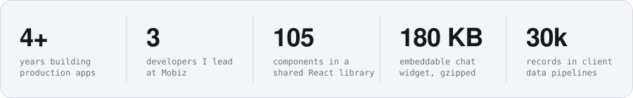
</picture>

## See it working


My portfolio runs a live agent demo built with **CopilotKit** and a browser-side **AG-UI** agent. Frontend tools render charts in the chat, a human-in-the-loop card waits for approval, and every protocol event is shown as it happens. No AI model or API key is involved.

  <a href="https://dolat-hamza-portfolio.vercel.app/#agent">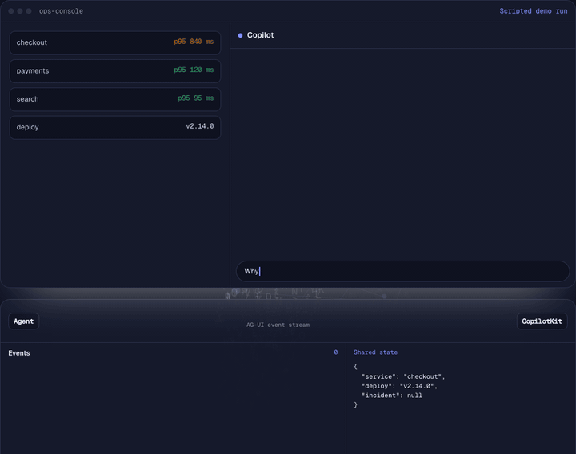</a>

The walkthroughs below recreate features I shipped, using sample data, since the real products belong to clients.

<table>
  <tr>
    <td width="50%" valign="top">
      <a href="https://dolat-hamza-portfolio.vercel.app/#inside">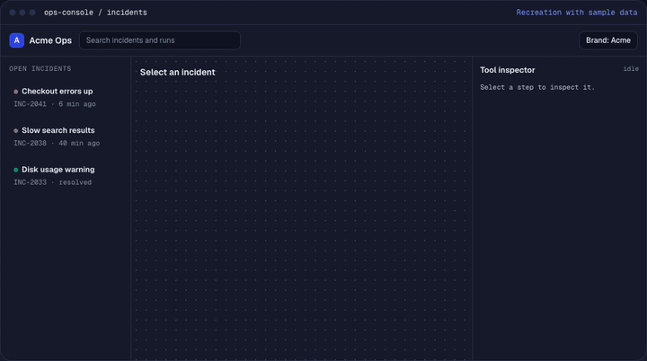</a>
       <b>Agent operations console</b> 
      The agent's plan as live cards, a tool inspector, change correlation and per-brand theming.
    </td>
    <td width="50%" valign="top">
      <a href="https://dolat-hamza-portfolio.vercel.app/#inside">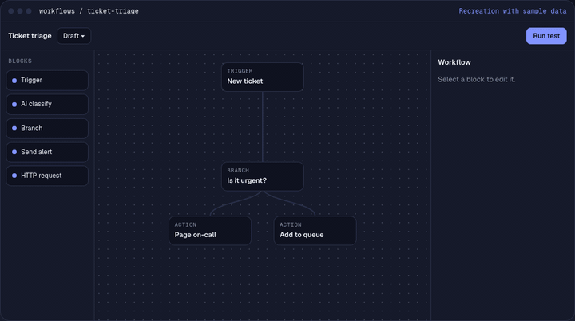</a>
       <b>Workflow editor</b> 
      Blocks from a shared component library, path variables, test results on the canvas and read-only promoted versions.
    </td>
  </tr>
  <tr>
    <td width="50%" valign="top">
      <a href="https://dolat-hamza-portfolio.vercel.app/#inside">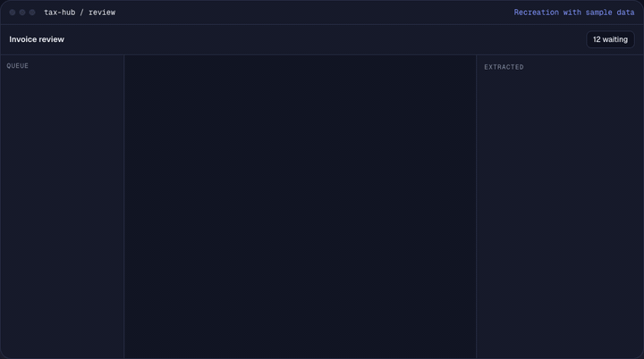</a>
       <b>AI tax copilot</b> 
      Invoices read field by field, classified, flagged for review and exported with an audit trail.
    </td>
    <td width="50%" valign="top">
      <a href="https://dolat-hamza-portfolio.vercel.app/#inside">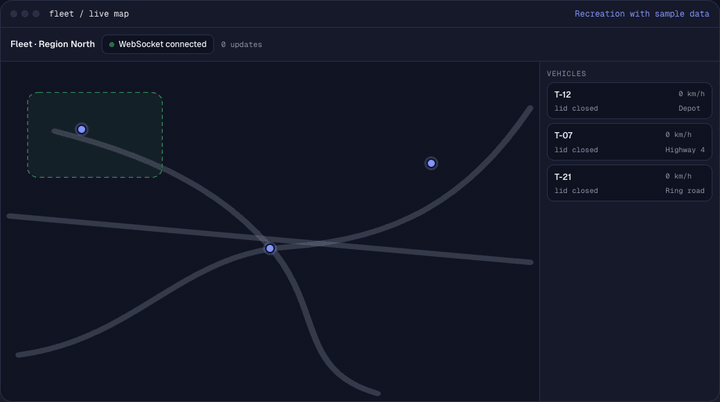</a>
       <b>Fleet tracking</b> 
      Live positions over WebSocket, vehicle details and a theft alert when a tank lid opens outside a safe zone.
    </td>
  </tr>
</table>

<a href="https://dolat-hamza-portfolio.vercel.app/#inside"><b>Watch all 12 walkthroughs on my portfolio</b></a>

 

<picture>
  <source media="(prefers-color-scheme: dark)" srcset="assets/experience-dark.svg">
  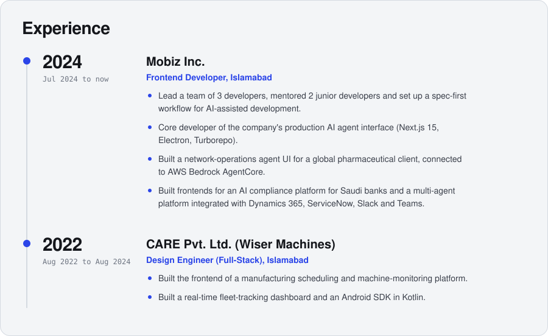
</picture>

  <a href="https://dolat-hamza-portfolio.vercel.app/#work"><picture><source media="(prefers-color-scheme: dark)" srcset="assets/work-dark.svg">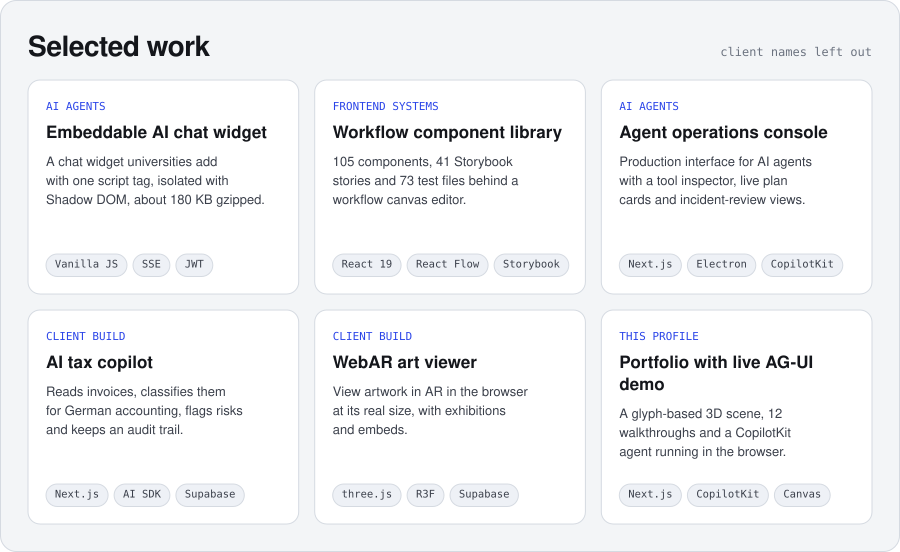</picture></a>

<picture>
  <source media="(prefers-color-scheme: dark)" srcset="assets/toolbox-dark.svg">
  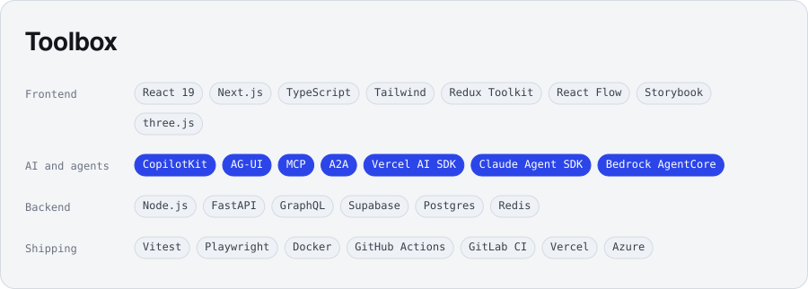
</picture>

  <a href="mailto:dolathamza8019@gmail.com"><picture><source media="(prefers-color-scheme: dark)" srcset="assets/contact-dark.svg">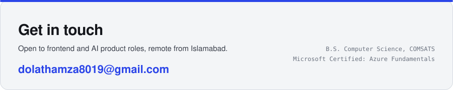</picture></a>

